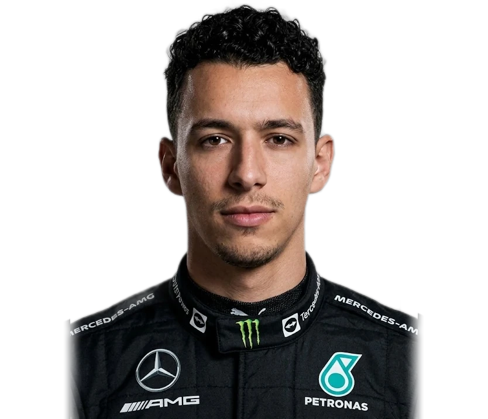

<div align="center">



# `///` ANAS GANA — PORTFOLIO

### 🏁 **driver_001** · Software Engineer · Casablanca, Morocco 🇲🇦

*An F1-inspired portfolio — 3D helmet, lap counter, sector times and pit stops.*

<br/>


[**🌐 Live demo**](https://YOUR-DOMAIN.vercel.app) &nbsp;·&nbsp; [**💼 LinkedIn**](https://www.linkedin.com/in/anas-gana-875378325) &nbsp;·&nbsp; [**✉️ Contact**](mailto:anasgana2003@gmail.com)

</div>

---

## 🏎️ The concept

Most portfolios are a list. This one is a **race weekend**.

You scroll through the circuit lap by lap, the cursor *burns through* the page to reveal a 3D helmet, and every section is dressed like live timing — because great software, like a great lap, is about precision.

| Race wording | What it is on the site |
|---|---|
| 🚦 **Lap 1/8 → 8/8** | Live progress chip + bar that follows your scroll |
| ⏱️ **Sector times** | Mobile · Web · Network — the three areas I work in |
| 🔧 **Pit stops** | My two internships, shown as timed stops |
| 🛣️ **The circuit** | Academic journey drawn as a track that fills as you scroll |
| 🏆 **Finish** | The contact section |

## ✨ Features

- 🎭 **F1 driver-style hero** — number plate, nationality flag, slanted surname and a sector-colour timing bar
- 🪖 **Interactive 3D helmet** (three.js + custom GLSL shaders) — a wireframe scan wave and a cursor-driven reveal
- 🌍 **FR / EN switch** — full translation in one click, remembered between visits, browser language detected on first load
- 📄 **CV download** — the right PDF (French or English) follows the selected language
- 🖼️ **Picture slots** for every project, journey step and company logo — several images rotate, click to enlarge
- 🌗 **Light & dark themes**, saved automatically
- 📱 **Fully responsive**, keyboard accessible, respects `prefers-reduced-motion`
- ⚡ **Static & fast** — prerendered by Next.js, no backend, no database

## 🧰 Tech stack

| Layer | Tools |
|---|---|
| Framework | Next.js 16 (App Router) · React 19 · TypeScript |
| 3D & motion | three.js · GLTFLoader · custom shaders · spring-based animations |
| Styling | Hand-written CSS (no UI library) · Oswald + Space Grotesk |
| Deploy | Vercel (zero config) |

## 🚀 Quick start

```bash
# 1. clone
git clone https://github.com/anas-gn/porfolio.git
cd porfolio

# 2. install
npm install

# 3. start the engine
npm run dev          # → http://localhost:3000
```

Production build:

```bash
npm run build && npm start
```

> **Requires** Node.js 20+

## 🗂️ Project structure

```text
.
├── app/
│   ├── layout.tsx            # SEO metadata, fonts, theme bootstrap
│   ├── page.tsx              # Page shell
│   ├── content.ts            # ✏️  All page markup & French text
│   ├── PortfolioScripts.tsx  # Loads scripts in the right order
│   ├── globals.css           # ✏️  Styles
│   └── icon.png              # Browser-tab icon
└── public/
    ├── js/
    │   ├── main.js           # 3D scene, animations, lap tracker
    │   ├── i18n.js           # ✏️  FR/EN dictionary, CV links, picture slots
    │   └── images-config.js  # ✏️  Where your project pictures are declared
    ├── images/               # 📸 Drop your screenshots here
    ├── cv/                   # 📄 Anas_Gana_CV_FR.pdf · Anas_Gana_CV_EN.pdf
    ├── models/helmet.glb     # 3D helmet
    └── img/portrait.webp     # Hero portrait
```

## 🛠️ Make it yours

<details>
<summary><b>📸 Add pictures to a project</b></summary>

1. Copy your screenshots into `public/images/`
2. Declare them in `public/js/images-config.js`:

```js
const IMAGES = {
  p1: ["/images/fitlek-1.png", "/images/fitlek-2.png"], // rotates automatically
  p2: ["/images/moroccofan.png"],
  // p1…p8 = projects · e1…e3 = journey photos · c1…c2 = company logos
};
```
</details>

<details>
<summary><b>➕ Add or remove a project</b></summary>

Edit the projects list in `app/content.ts`, copy an existing `item` block, then update its number, title, description, link and `data-slot` (`p9`, `p10`…). Add the matching key in `images-config.js`.
</details>

<details>
<summary><b>🌍 Edit translations</b></summary>

French text lives in `app/content.ts`; English text is the `FR2EN` dictionary at the top of `public/js/i18n.js`.
</details>

<details>
<summary><b>📄 Update the CVs</b></summary>

Replace the two PDFs in `public/cv/` and keep the file names.
</details>

## ☁️ Deploy in 60 seconds

1. Push this repo to GitHub
2. Import it on [vercel.com/new](https://vercel.com/new)
3. Click **Deploy** — that's the chequered flag 🏁

## 🙌 Credits

- 3D helmet **"Battle Damaged Sci-fi Helmet"** by *theblueturtle_* — [CC BY 4.0](https://creativecommons.org/licenses/by/4.0/)
- [three.js](https://threejs.org/) — MIT
- Typefaces: Oswald & Space Grotesk (Google Fonts, OFL)

## 📬 Let's work together

I'm currently looking for a **final-year internship (PFE)** in software development & information systems.

[](https://www.linkedin.com/in/anas-gana-875378325)
[](https://github.com/anas-gn)
[](mailto:anasgana2003@gmail.com)

---

<details>
<summary><b>🇫🇷 En français</b></summary>

<br/>

**Portfolio d'Anas Gana**, ingénieur logiciel (Flutter, Next.js, Spring Boot, DevOps) — Master 2 Réseaux & Systèmes d'Information, FST Settat. Un site au thème **Formule 1** : casque 3D interactif, compteur de tours, temps par secteur, arrêts au stand, bascule **FR / EN**, téléchargement du CV, thème clair/sombre.

```bash
npm install
npm run dev     # http://localhost:3000
```

Ajouter des images de projets : copier les fichiers dans `public/images/`, puis les déclarer dans `public/js/images-config.js`.

Je recherche un **stage de fin d'études (PFE)** — contactez-moi : anasgana2003@gmail.com

</details>

<div align="center">

<sub>Built with ☕, curiosity and way too many lap times. &nbsp;© 2026 Anas Gana</sub>

</div>
